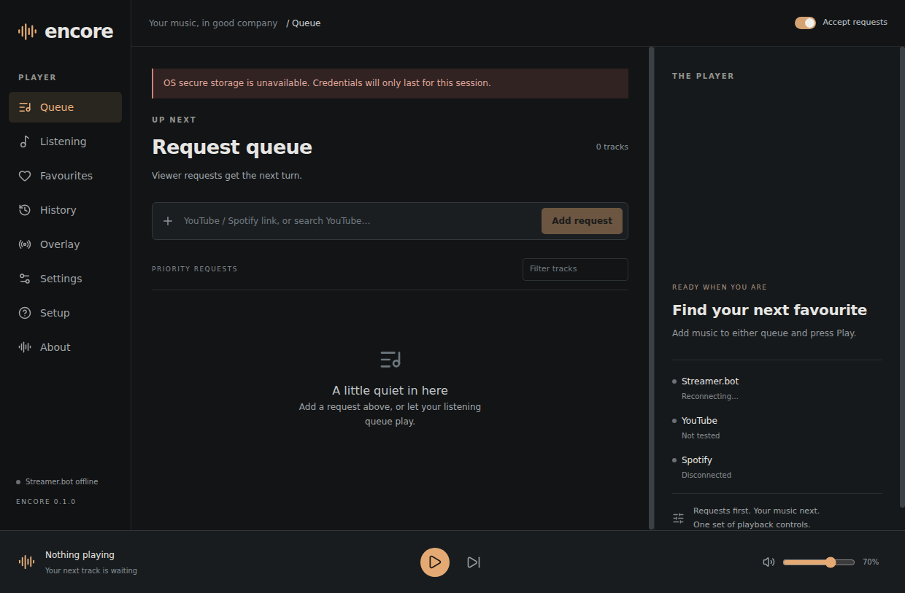

# Encore

Encore is a desktop music player with a Streamer.bot request queue, based on [Better Song Request by HackMe_](https://github.com/xHackMe/better-song-request-streamerbot). It adds an Electron desktop experience, a redesigned interface and guided setup while retaining the upstream request-action contract.

One queue and transport switch between Spotify browser playback and YouTube playback inside Encore. Personal listening works without Streamer.bot. Viewer requests take the next available slot before personal tracks and the rotating base playlist; they do not interrupt the current song. No separate Spotify or YouTube app is required.

**Development preview:** account playback and packaged Windows DRM still require verification. Spotify does not officially list Electron as a supported SDK browser. YouTube requires its visible official video player, so Encore cannot provide a completely iframe-free audio implementation. See [playback evidence and restrictions](docs/PLAYBACK.md) before distributing or using this for a broadcast.



Actual Electron application running on Linux/WSL, with an empty queue and no connected accounts. Connection and secure-storage warnings are real.

## Windows installation

Download the Windows installer or portable package from [Encore Releases](https://github.com/Timmsy1998/Encore/releases).

- `Encore-VERSION-windows-x64-installer.exe`: per-user NSIS installation; optional launch at login.
- `Encore-VERSION-windows-x64-portable.exe`: run from a writable folder without administrator access. Settings live in `Encore-data` beside the executable. Keep that folder when moving the app. Read-only locations produce an error rather than silently losing settings.

Check downloads against `SHA256SUMS.txt` using PowerShell `Get-FileHash`. Unsigned builds can trigger Windows SmartScreen. Signing and DRM status must be stated in each release's notes.

Installed data uses Electron's user-data directory (normally `%APPDATA%/Encore` or `%APPDATA%/encore-desktop`, depending on package identity); Settings shows the exact location. Credentials use OS encryption where available. Without secure storage, Encore keeps credentials for the session only and displays a warning. Backups exclude credentials.

## First run

The eight-step setup can be skipped, resumed and reopened from Settings:

1. Read the playback and request overview.
2. For chat requests, run Streamer.bot with its local WebSocket server enabled. Match the port (default 8080), enter its password and connect. Streamer.bot must remain running for requests and replies; personal playback is independent.
3. Copy Encore's supplied upstream 1.1.0 action import into Streamer.bot, configure channel commands and permissions there, and run import diagnostics. Encore serves its own UI and overlay; Streamer.bot HTTP hosting is unnecessary.
4. Enable YouTube Data API v3 in a Google project, enter an API key and test it. Titles search YouTube; YouTube links resolve directly. Quotas, deleted videos and embedding restrictions are reported.
5. Optionally create a Spotify developer app with Web Playback SDK/Web API access. Register **`http://127.0.0.1:17843/callback` exactly**. Enter the Client ID and connect in the system browser. No Client Secret is needed. Spotify Premium and developer-app account access are required. Authorization alone does not establish a ready playback device.
6. Add a supported Spotify or YouTube playlist for fallback music, or add personal tracks in Listening.
7. Optionally configure the silent OBS overlay.
8. Add a real test request and press Play. Check each provider and switching with your own accounts.

Queue rows support drag ordering and keyboard-accessible move buttons, favourites, banning and removal. History can requeue tracks. Requests on/off, skip, play/pause and volume stay available across pages. Settings includes limits, skip votes, reply formatting, backup/restore and import diagnostics. A restart restores queued/current music **paused**, without autoplay. Close-to-tray is opt-in: Spotify can continue; YouTube pauses when hidden/minimised to respect its visible-player requirement.

## Streamer.bot commands

The supplied import retains the upstream `General.Custom` event names: `SONG_REQUEST`, `SPOTIFY_SONG_REQUEST`, `SONG_REQUEST_FORCE`, `GET_SONG`, `WHEN_SONG`, `QUEUE_SONGS`, `SKIP_SONG`, `VOTE_SKIP`, `WRONG_SONG`, `VOLUME`, `PLAY_SONG`, `PAUSE_SONG`, `STOP_SONG`, and `IMPORT_DIAGNOSTICS`. Command aliases, moderator restrictions and channel-point bindings belong in Streamer.bot. Do not grant viewers unrestricted access to forced requests or moderator actions.

Encore authenticates and subscribes once per WebSocket connection, reconnects with backoff, deduplicates event IDs and rapid repeated requests, and throttles replies. Import diagnostics compare reported version/capabilities; they cannot verify every channel permission. [Parity details](docs/UPSTREAM.md).

## OBS

Open Overlay, choose Default overlay or Add overlay, and copy its browser-source URL into OBS at 960 × 260 for horizontal cards or 960 × 1100 for vertical galleries. Create up to 20 additional overlays with independent styles, colours, dimensions and visibility controls, and use several Browser sources together. Add overlay copies the selected design. Rename a saved overlay without changing its URL; deleting it hides that source. The default URL remains compatible. Choose optional spinning vinyl artwork. Equalizer bars animate during playback and songs crossfade smoothly; reduced-motion settings disable animation. Requester attribution appears only for requests, and platform badges stay hidden. Designs persist across restarts and update live; the preview/test is explicitly labelled sample data. Encore must be running. The overlay exposes only current-track information.

**The overlay has no audio.** Capture Encore's application audio once for both sources. Avoid capturing the same audio again through Desktop Audio. YouTube video remains visible in Encore's provider panel; Spotify plays through Encore's browser device. Verify your OBS capture path on Windows and obtain the necessary music/broadcast rights.

## Troubleshooting

- **Spotify device never becomes ready:** confirm Premium, app/account allowlisting, exact redirect, network access and DRM support. A packaged Windows build needs Castlabs VMP signing. See [playback](docs/PLAYBACK.md).
- **YouTube error 100/101/150/153:** video unavailable, embedding disabled or player-origin restrictions. Try another playable video. Keep Encore visible; there is no extraction fallback.
- **API test works but no audio:** metadata validation does not test playback. Select a real track, press Play, check volume and device/Windows mixer. Provider errors pause playback for recovery; skip explicitly to continue.
- **Requests do not arrive:** run Streamer.bot, check local port/password, import actions and run diagnostics. Check command permissions in Streamer.bot.
- **Port 17843 unavailable:** stop the conflicting process and restart Encore. The fixed loopback address is also the registered OAuth redirect.
- **Credentials disappear after restart:** secure storage is unavailable; Encore intentionally avoids plaintext fallback. Use an OS keychain/Windows account with functioning secure storage.
- **Damaged/unknown settings:** Encore preserves a recovery copy and shows the failure. Restore a version-1 backup; do not overwrite the only recovery copy.
- **Updates:** Installed copies check stable GitHub releases on startup and every six hours, download in the background, and offer Restart and install. About also offers a manual check. Portable users replace the executable through Releases and retain the adjacent data folder.

## Development

Use Node 22.12+ and npm. From the repository root:

```sh
npm ci
npm run check
npm run dev
```

`npm run runtime` downloads the pinned, SHA-256-verified Castlabs Electron build. `npm run dev` launches it after building. `npm run preview` is only a renderer preview; desktop functionality requires the preload/main process. Provider credentials are entered in Encore, never bundled or committed.

```sh
npx playwright install chromium
npm run test:ui
npm run build
npm run runtime
npm run test:desktop
npm run package:win
```

Windows packaging should run on Windows. Linux UI tests need Chromium system libraries; desktop smoke needs a graphical session. See [architecture/security](docs/ARCHITECTURE.md), [release instructions](docs/RELEASE.md) and [verification record](docs/VERIFICATION.md).

## Known limitations

Real-account playback, Windows installer/portable behaviour and OBS capture are release gates, not verified results of the automated suite. Spotify's policy restricts integration with another service's content; provider permission and broadcast rights must be resolved before distribution/use. Upstream's six translations remain in the original browser source; Encore's new UI is English only. Overlay offers three customisable styles and independent saved designs rather than all legacy themes. No progress seeking, Linux/macOS distribution or stream downloading is provided.

## Licence and attribution

GPL-3.0-only; see the preserved [LICENSE](LICENSE). Encore derives from **[Better Song Request](https://github.com/xHackMe/better-song-request-streamerbot)** by HackMe_ and contributors. Original browser sources and copyright notices remain in the repository for attribution and comparison. The desktop application uses `src/`, `desktop/` and `public/`; it does not load the legacy root HTML as privileged content. Distributions must preserve the licence and provide corresponding source under GPL obligations. Spotify, YouTube, Electron and Castlabs are separate projects/services; no affiliation is implied.
